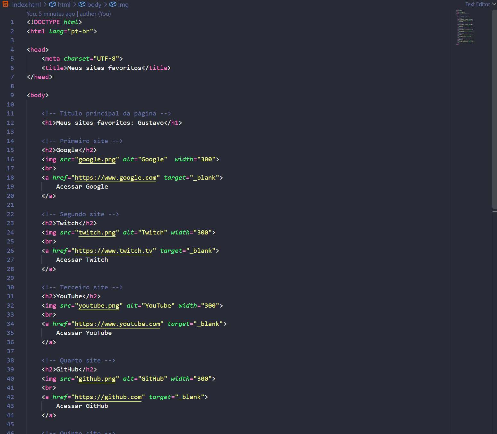
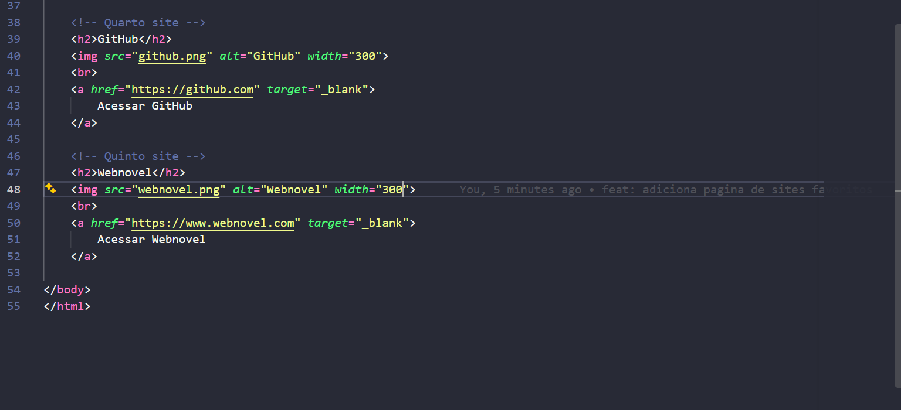
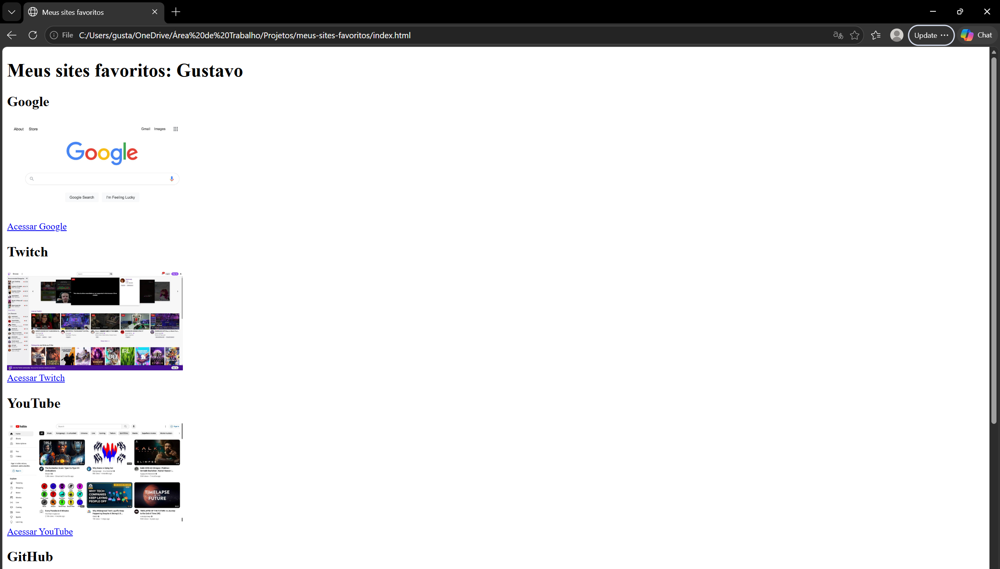
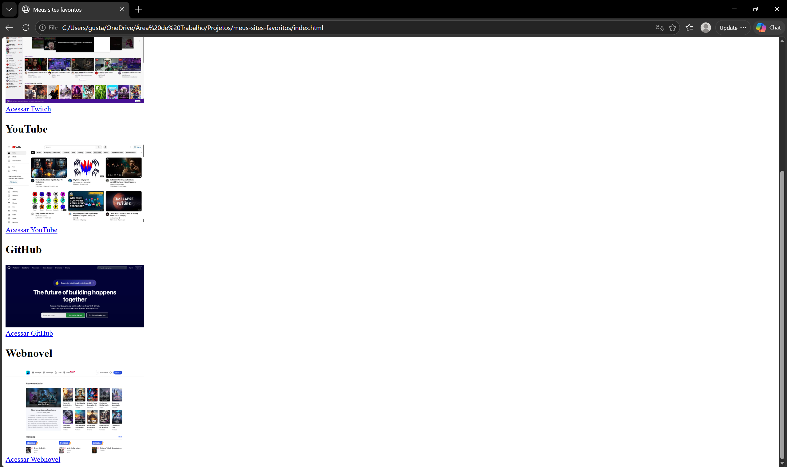

# 🌐 Meus Sites Favoritos

Projeto desenvolvido como atividade prática para aplicar conhecimentos básicos de HTML.

## 📌 Sobre o projeto

A página reúne cinco dos meus sites favoritos, apresentando o nome de cada site, sua imagem e um link para acessá-lo.

## ⭐ Sites selecionados

* [Google](https://www.google.com)
* [Twitch](https://www.twitch.tv)
* [YouTube](https://www.youtube.com)
* [GitHub](https://github.com)
* [Webnovel](https://www.webnovel.com)

## 🛠️ Tecnologias utilizadas

* HTML5

## 📸 Capturas de tela

### Código HTML

### Página no navegador

## 🎯 Objetivo

Praticar a utilização de tags HTML, incluindo títulos, imagens, links e a estrutura básica de uma página.